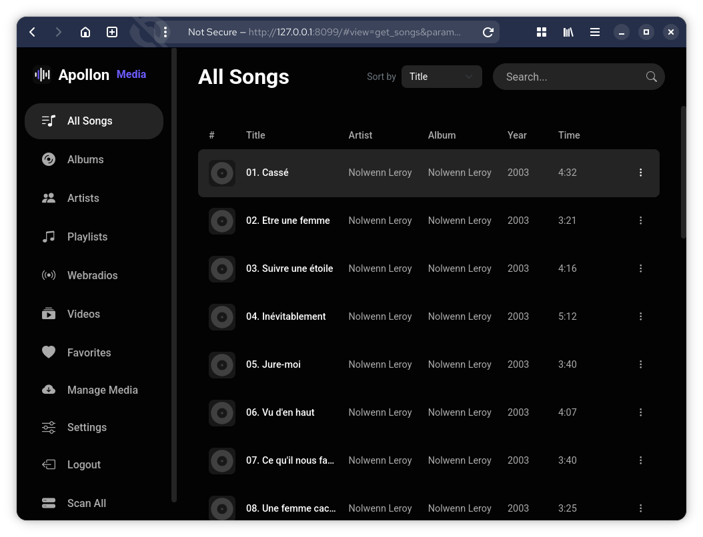
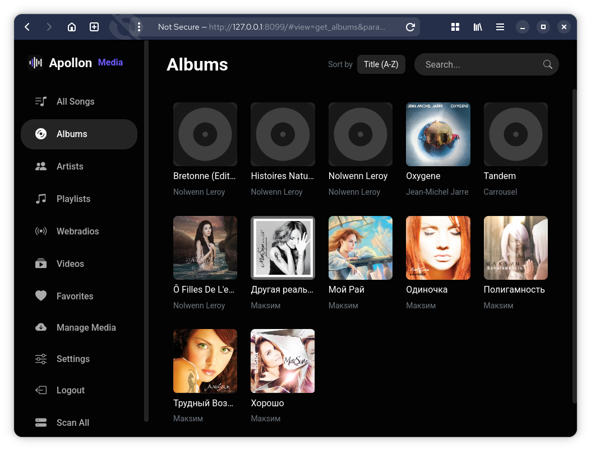
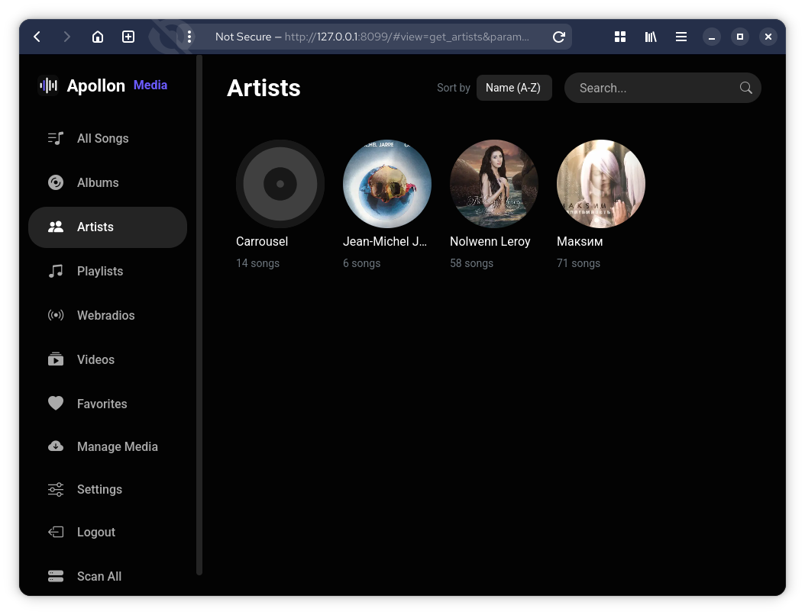
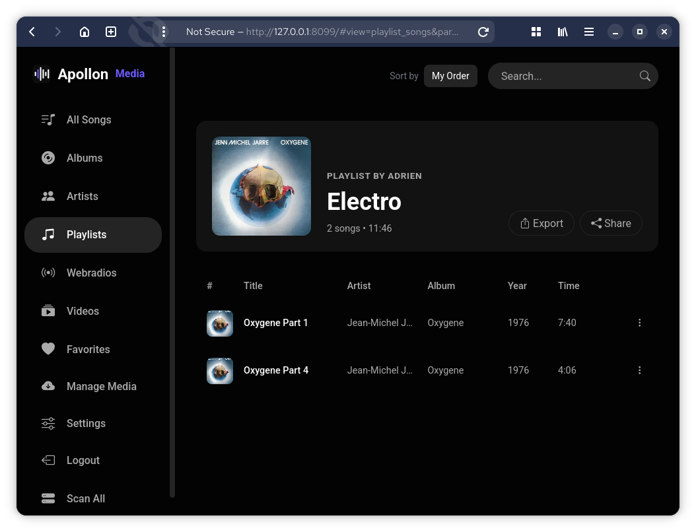
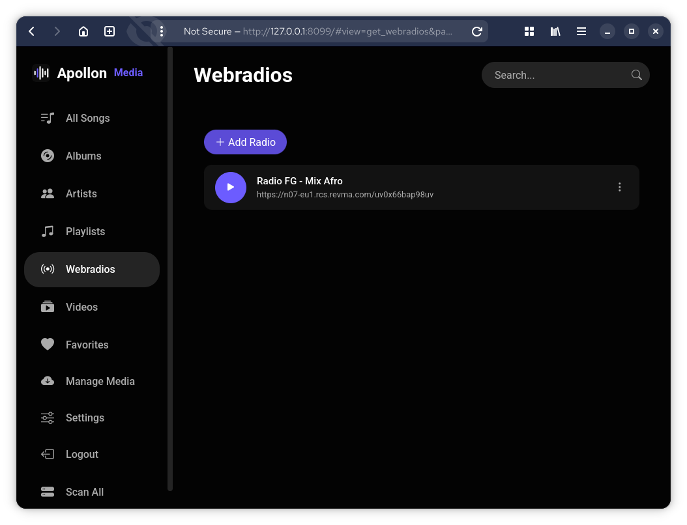
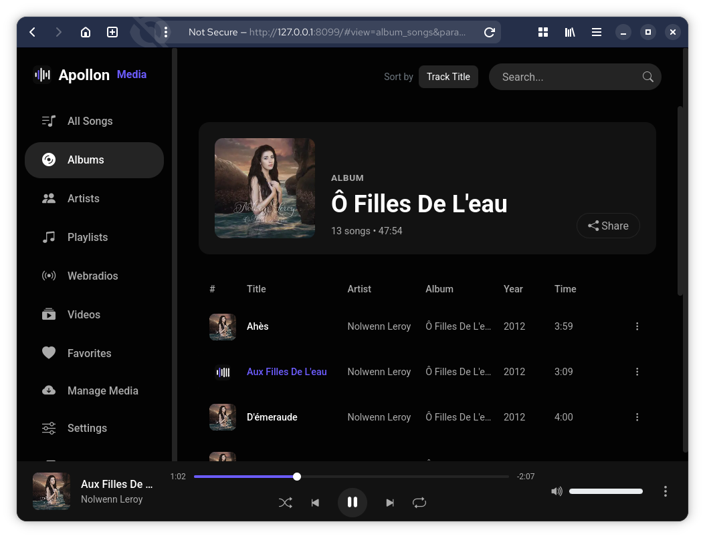
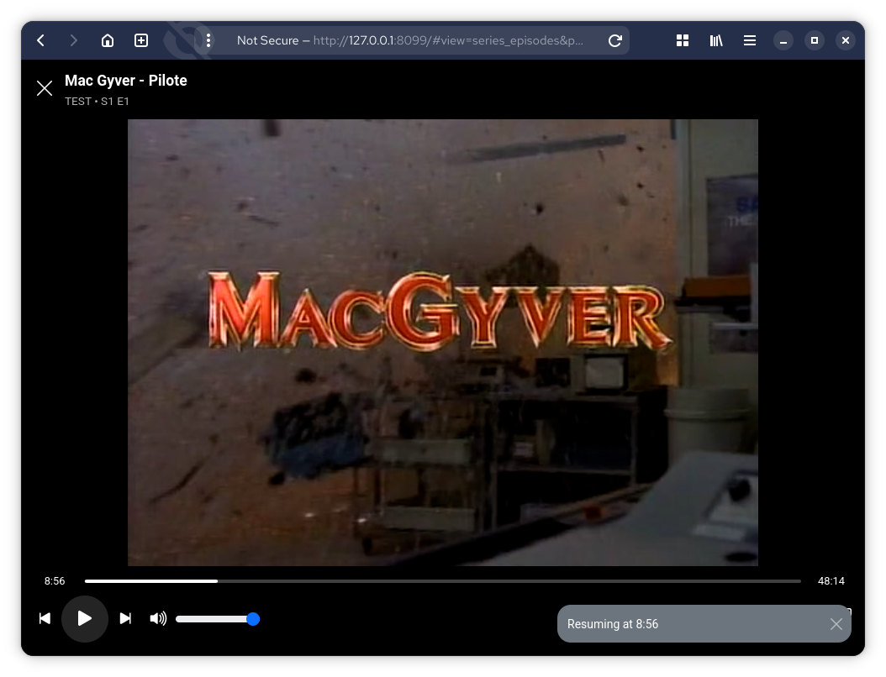
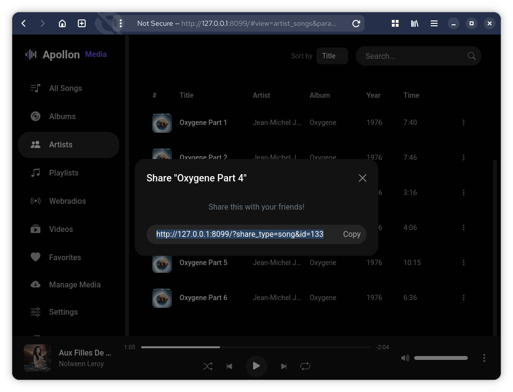
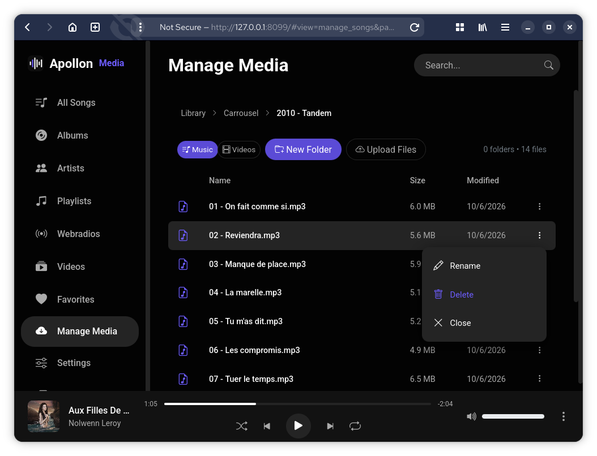
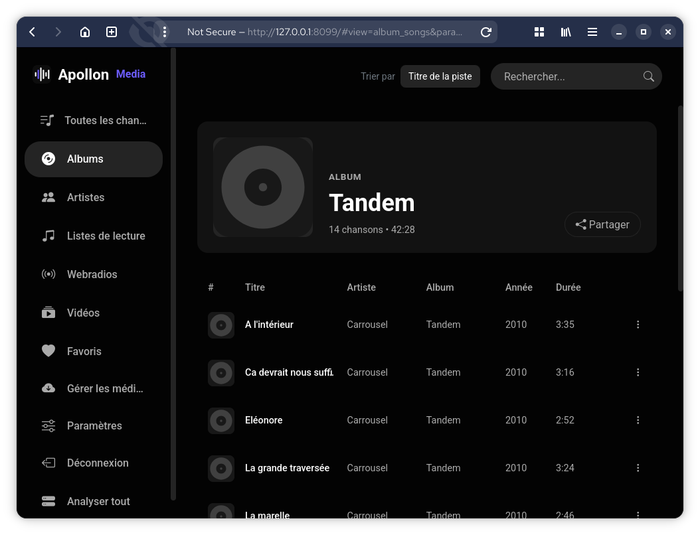

# Apollon Media

**Apollon Media** est un lecteur de musique et de vidéos auto-hébergé, léger et rapide, écrit en PHP pur (sans framework ni dépendance Composer). Il scanne votre bibliothèque audio et vidéo, lit les métadonnées (getID3), et propose une interface sombre inspirée de YouTube Music, responsive et installable en PWA.

Fonctionnalités principales :

- **Bibliothèque musicale** (mp3, m4a, flac, ogg, wav) : albums, artistes, favoris, playlists, recherche, tri.
- **Films & séries** (mp4, mkv, webm, avi, mov, ts, wmv) : détection saison/épisode, posters, transcodage automatique via ffmpeg. **(nouvellement intégré donc pas tout à fait au point)**
- **Lecture en streaming** (audio & vidéo) : file de lecture, shuffle, repeat, Media Session, cache OPFS.
- **Webradios** : liste de flux radio HTTP partagée par tous les utilisateurs, lecture en direct (streaming proxifié par le serveur).
- **Comptes & partage** : inscription/connexion, liens de partage (chansons, albums, artistes, playlists) et écoute d'une chanson partagée par un invité.
- **Gestionnaire de fichiers** (Manage) avec upload, **multilingue** (EN/FR), **PWA**.



## Prérequis

- **PHP 8.1+** avec les extensions `pdo_sqlite` et `gd` (GD pour la conversion des cover art en WebP ; sans GD, le scan fonctionne mais les images seront absentes).
- **ffmpeg + ffprobe** dans le `PATH` du serveur (recommandé) : requis pour transcoder les vidéos non supportées par les navigateurs (AVI, MKV, HEVC…). Sans ffmpeg, seules les vidéos MP4/WebM (H.264/AAC) sont lisibles.
- Un serveur web (Apache, nginx) + php-fpm

## Installation

1. Copiez le projet sur votre serveur.
2. Créez la configuration à partir du modèle :

   ```bash
   cp config.php.sample config.php
   ```

   puis ajustez `config.php` si besoin (dossiers, inscription, écoute invités, transcodage…).
3. Placez vos fichiers audio dans `music/` et vos vidéos dans `videos/` (modifiables via `MUSIC_DIR` / `VIDEO_DIR`).
4. Assurez-vous que le dossier `data/` est accessible en écriture par le processus PHP (la base SQLite `data/music.db` y est créée automatiquement).
5. Pointez la racine de votre vhost vers ce dossier (voir [Configuration serveur](#configuration-serveur)).

## Configuration serveur

### Apache

Le vhost pointe vers le dossier du projet avec `index.php` comme document par défaut :

```apache
<VirtualHost *:80>
    ServerName apollon.local
    DocumentRoot /var/www/apollon

    <Directory /var/www/apollon>
        AllowOverride All
        Require all granted
        DirectoryIndex index.php
    </Directory>
</VirtualHost>
```

Le dossier `data/` est protégé par son propre `.htaccess` (`Require all denied`) : la base SQLite et le cache vidéo ne sont jamais accessibles depuis le web.

### nginx + php-fpm

```nginx
server {
    listen 80;
    server_name apollon.local;
    root /var/www/apollon;
    index index.php;

    # Protège la base de données et le cache vidéo
    location ^~ /data/ {
        deny all;
    }

    location / {
        try_files $uri /index.php$is_args$args;
    }

    location ~ \.php$ {
        include fastcgi_params;
        fastcgi_pass unix:/run/php/php8.2-fpm.sock;
        fastcgi_param SCRIPT_FILENAME $document_root$fastcgi_script_name;
    }
}
```

> Toutes les actions passent par des requêtes `?action=…` (et `?share_type=…`) : aucune réécriture d'URL n'est strictement nécessaire. Les blocs ci-dessus garantissent simplement que `/` sert `index.php` et que `data/` reste inaccessible.

## Configuration

Toutes les options sont dans `config.php` (créé depuis `config.php.sample`, seul fichier versionné — `config.php` est ignoré par git) :

| Constante | Description | Valeur par défaut |
|---|---|---|
| `APP_NAME` | Nom affiché de l'application | `Apollon Media` |
| `MUSIC_DIR` | Dossier scanné pour les fichiers audio | `__DIR__ . '/music'` |
| `VIDEO_DIR` | Dossier scanné pour les vidéos (films & séries) | `__DIR__ . '/videos'` |
| `DB_FILE` | Emplacement de la base SQLite | `__DIR__ . '/data/music.db'` |
| `PAGE_SIZE` | Nombre de titres par page (scroll infini) | `25` |
| `AUDIO_EXTENSIONS` | Extensions audio acceptées | `mp3, m4a, flac, ogg, wav` |
| `VIDEO_EXTENSIONS` | Extensions vidéo acceptées | `mp4, m4v, mkv, webm, avi, mov, ts, wmv` |
| `SESSION_LIFETIME` | Durée de vie du cookie de session (secondes) | `31536000` (1 an) |
| `ALLOW_REGISTRATION` | Autorise l'inscription (masque le formulaire Register si `false`) | `false` |
| `ALLOW_GUEST_LISTEN` | Écoute sans connexion. Si `false`, les visiteurs voient une page d'accueil/connexion | `false` |
| `SHARE_SECRET` | Clé de signature des jetons de partage de chanson (requis si `ALLOW_GUEST_LISTEN` est `false`). Générer : `php -r "echo bin2hex(random_bytes(32));"` | — |
| `SHARE_TOKEN_TTL` | Durée de vie d'un jeton de partage (secondes, `0` = jamais) | `0` |
| `VIDEO_TRANSCODE` | Transcodage ffmpeg des formats non supportés par les navigateurs | `true` |
| `VIDEO_CACHE_DIR` | Dossier de cache des MP4 transcodés | `__DIR__ . '/data/video_cache'` |
| `MAX_UPLOAD_SIZE` | Taille max d'un fichier uploadé (octets) | `5 Go` |

## Utilisation

### Première prise en main

Après l'installation, cliquez sur **Scan All** pour indexer la bibliothèque. La page d'accueil liste toutes les chansons avec recherche et tri.

### Navigation

- **Toutes les chansons** : liste paginée (scroll infini), recherche, tri multiple.
- **Albums** / **Artistes** : grilles avec cover art.
- **Favoris** : ajout/retrait, réordonnancement par glisser-déposer.
- **Playlists** : création, édition, partage, export/import JSON.
- **Webradios** : liste de flux radio partagée (nom + URL), ajout/modification/suppression, lecture en direct.







### Webradios

Section réservée aux utilisateurs connectés : une liste de flux radio HTTP **partagée par tous les utilisateurs** (chaque flux est défini par un nom et une URL). Vous pouvez y ajouter, modifier et supprimer des flux, et les écouter en direct depuis le lecteur.

Les flux sont **streamés via le serveur** (proxy) plutôt que lus directement par le navigateur : de nombreux flux radio passent par une redirection tokenisée qui pose un cookie, et les navigateurs bloquent ce cookie tiers pour les requêtes média cross-origin. Le proxy suit la redirection (cURL) et renvoie l'audio au navigateur depuis la même origine.



### Lecture

Le lecteur audio prend en charge le streaming (seek), la file de lecture, shuffle, repeat et le Media Session (contrôles verrouillage). Les pistes sont mises en cache dans l'OPFS du navigateur.



### Vidéos (films & séries)

Le dossier `videos/` est scanné ; les films et séries sont détectés d'après l'arborescence des dossiers. Les formats non supportés par le navigateur sont transcodés en MP4 (barre de progression dans le lecteur).



### Partage

Chansons, albums, artistes et playlists peuvent être partagés par lien. Si `ALLOW_GUEST_LISTEN` est `false`, un invité ne peut écouter qu'une chanson partagée (jeton signé, limité à cette piste).



### Manage (gestionnaire de fichiers)

Réservé aux utilisateurs connectés : parcourir la bibliothèque, créer/renommer/supprimer des dossiers et fichiers, et uploader des fichiers audio ou vidéo (indexés immédiatement).



### Interface multilingue

L'interface (menus, pages publiques, messages de l'API, e-mails par défaut) est disponible en anglais et en français et est **détectée automatiquement depuis l'en-tête `Accept-Language` du navigateur** — aucun paramètre d'URL ni cookie n'est nécessaire. Les traductions vivent dans `lang/<code>.php` (l'anglais est la source de vérité et la langue de repli).



## Développement assisté par IA

Ce projet a été développé avec l'assistance d'un modèle d'IA, **Qwen3.8 27B, exécuté enlocal** :
- l'**interface multilingue** (l'application a initialement été développée uniquement en français) a été réalisée avec son assistance ;
- le **style CSS** de l'application a été produit à partir du projet [Lethe](https://github.com/aaaaadrien/lethe)).
