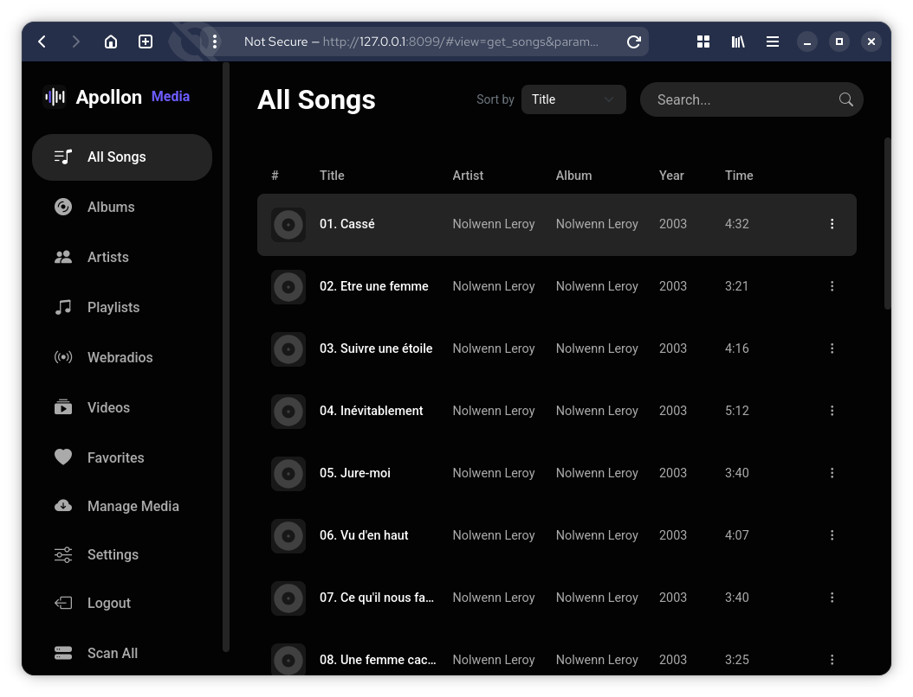
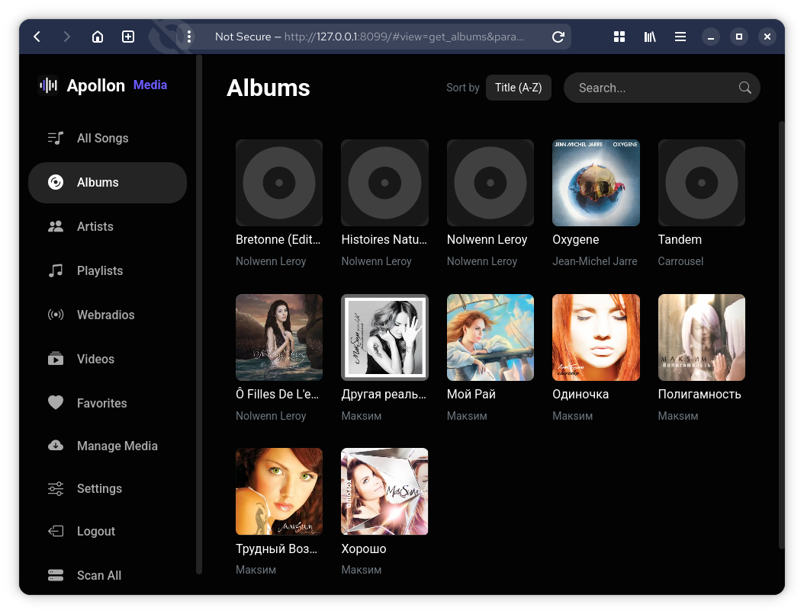
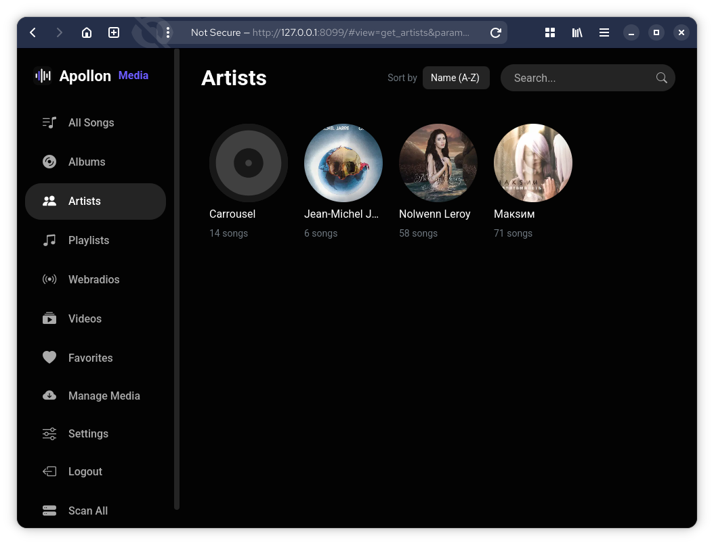
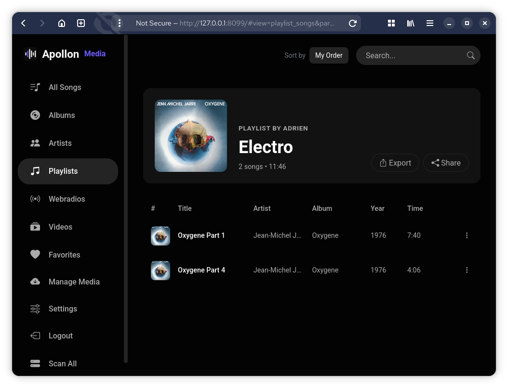
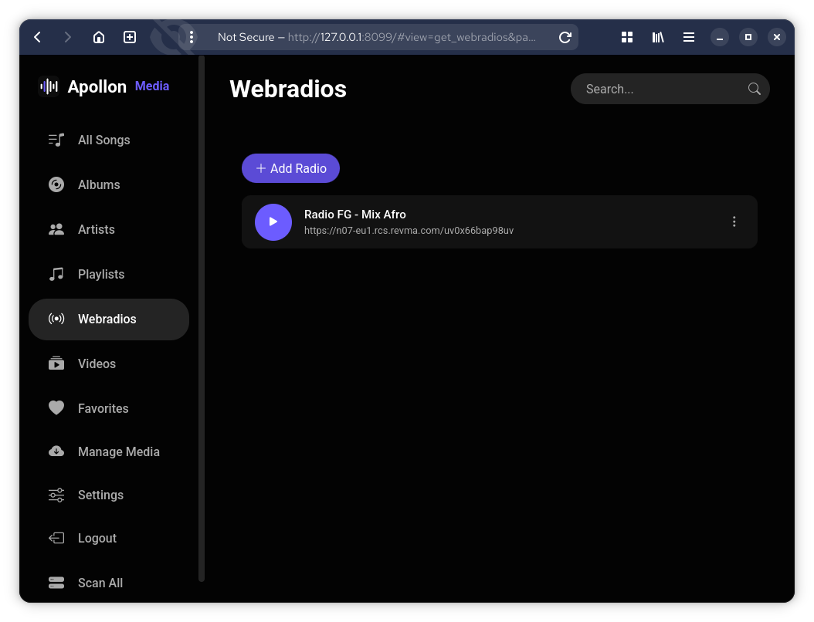
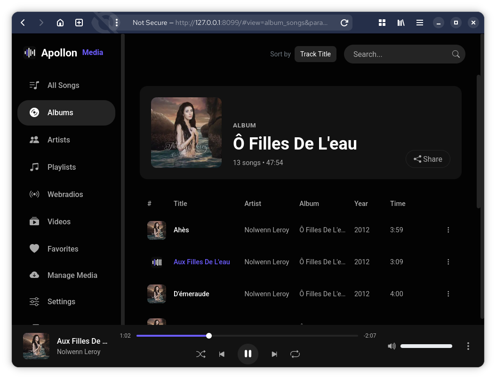
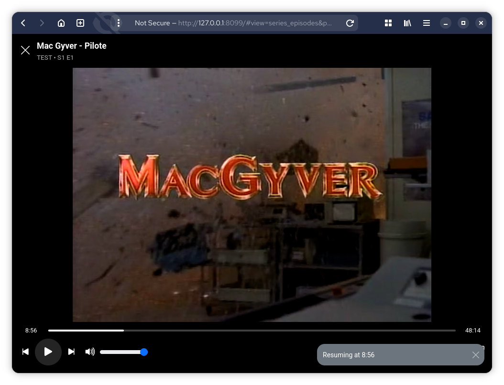
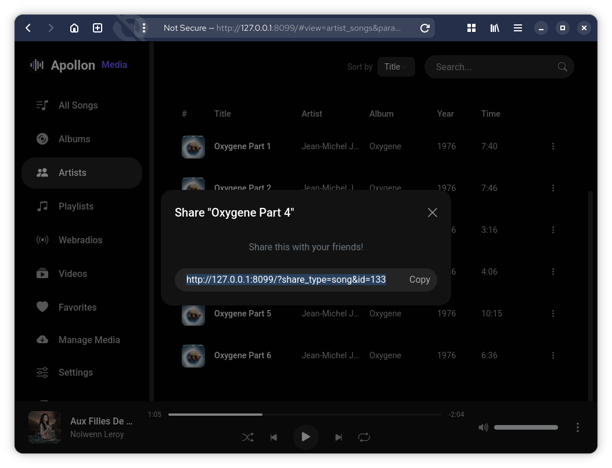
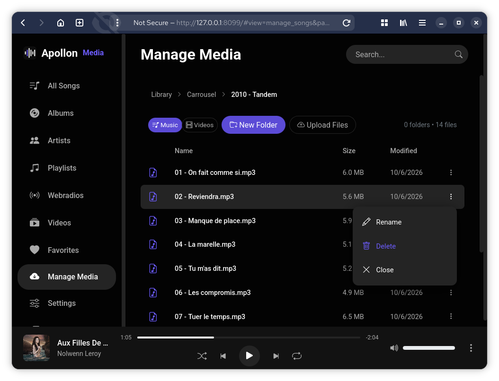
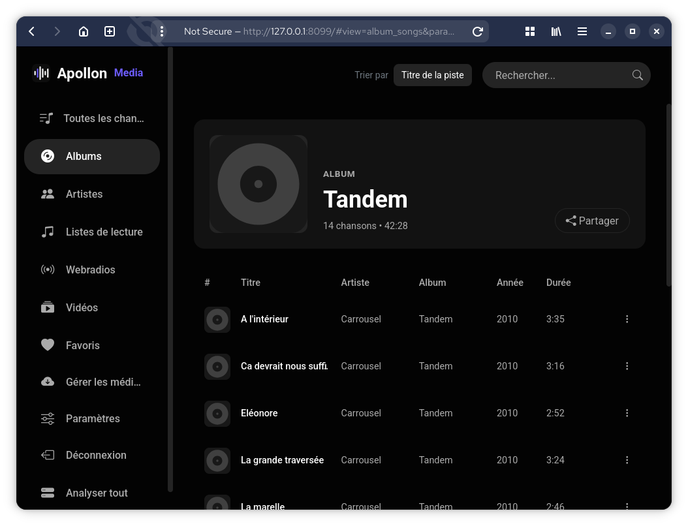

# Apollon Media

**Apollon Media** is a self-hosted, lightweight and fast music and video player, written in pure PHP (no framework, no Composer dependencies). It scans your audio and video library, reads the metadata (getID3), and provides a dark interface inspired by YouTube Music, responsive and installable as a PWA.

Key features:

- **Music library** (mp3, m4a, flac, ogg, wav): albums, artists, favorites, playlists, search, sorting.
- **Movies & series** (mp4, mkv, webm, avi, mov, ts, wmv): season/episode detection, posters, automatic transcoding via ffmpeg. **(newly integrated, so not quite polished yet)**
- **Streaming playback** (audio & video): queue, shuffle, repeat, Media Session, OPFS cache.
- **Webradios**: a list of HTTP radio streams shared by all users, live playback (stream proxied by the server).
- **Accounts & sharing**: registration/login, share links (songs, albums, artists, playlists) and listening to a shared song as a guest.
- **File manager** (Manage) with upload, **multilingual** (EN/FR), **PWA**.



## Prerequisites

- **PHP 8.1+** with the `pdo_sqlite` and `gd` extensions (GD for converting cover art to WebP; without GD, the scan works but images will be missing).
- **ffmpeg + ffprobe** in the server's `PATH` (recommended): required to transcode videos not supported by browsers (AVI, MKV, HEVC…). Without ffmpeg, only MP4/WebM (H.264/AAC) videos are playable.
- A web server (Apache, nginx) + php-fpm

## Installation

1. Copy the project to your server.
2. Create the configuration from the template:

   ```bash
   cp config.php.sample config.php
   ```

   then adjust `config.php` if needed (folders, registration, guest listening, transcoding…).
3. Place your audio files in `music/` and your videos in `videos/` (changeable via `MUSIC_DIR` / `VIDEO_DIR`).
4. Make sure the `data/` folder is writable by the PHP process (the SQLite database `data/music.db` is created there automatically).
5. Point your vhost root to this folder (see [Server configuration](#server-configuration)).

## Server configuration

### Apache

The vhost points to the project folder with `index.php` as the default document:

```apache
<VirtualHost *:80>
    ServerName apollon.local
    DocumentRoot /var/www/apollon

    <Directory /var/www/apollon>
        AllowOverride All
        Require all granted
        DirectoryIndex index.php
    </Directory>
</VirtualHost>
```

The `data/` folder is protected by its own `.htaccess` (`Require all denied`): the SQLite database and the video cache are never accessible from the web.

### nginx + php-fpm

```nginx
server {
    listen 80;
    server_name apollon.local;
    root /var/www/apollon;
    index index.php;

    # Protects the database and the video cache
    location ^~ /data/ {
        deny all;
    }

    location / {
        try_files $uri /index.php$is_args$args;
    }

    location ~ \.php$ {
        include fastcgi_params;
        fastcgi_pass unix:/run/php/php8.2-fpm.sock;
        fastcgi_param SCRIPT_FILENAME $document_root$fastcgi_script_name;
    }
}
```

> All actions go through `?action=…` requests (and `?share_type=…`): no URL rewriting is strictly required. The blocks above simply ensure that `/` serves `index.php` and that `data/` stays inaccessible.

## Configuration

All options are in `config.php` (created from `config.php.sample`, the only versioned file — `config.php` is ignored by git):

| Constant | Description | Default value |
|---|---|---|
| `APP_NAME` | Display name of the application | `Apollon Media` |
| `MUSIC_DIR` | Folder scanned for audio files | `__DIR__ . '/music'` |
| `VIDEO_DIR` | Folder scanned for videos (movies & series) | `__DIR__ . '/videos'` |
| `DB_FILE` | SQLite database location | `__DIR__ . '/data/music.db'` |
| `PAGE_SIZE` | Number of tracks per page (infinite scroll) | `25` |
| `AUDIO_EXTENSIONS` | Accepted audio extensions | `mp3, m4a, flac, ogg, wav` |
| `VIDEO_EXTENSIONS` | Accepted video extensions | `mp4, m4v, mkv, webm, avi, mov, ts, wmv` |
| `SESSION_LIFETIME` | Session cookie lifetime (seconds) | `31536000` (1 year) |
| `ALLOW_REGISTRATION` | Allows registration (hides the Register form if `false`) | `false` |
| `ALLOW_GUEST_LISTEN` | Listening without login. If `false`, visitors see a landing/login page | `false` |
| `SHARE_SECRET` | Signing key for song share tokens (required if `ALLOW_GUEST_LISTEN` is `false`). Generate: `php -r "echo bin2hex(random_bytes(32));"` | — |
| `SHARE_TOKEN_TTL` | Share token lifetime (seconds, `0` = never) | `0` |
| `VIDEO_TRANSCODE` | ffmpeg transcoding of formats not supported by browsers | `true` |
| `VIDEO_CACHE_DIR` | Cache folder for transcoded MP4s | `__DIR__ . '/data/video_cache'` |
| `MAX_UPLOAD_SIZE` | Max size of an uploaded file (bytes) | `5 GB` |

## Usage

### Getting started

After installation, click **Scan All** to index the library. The home page lists all songs with search and sorting.

### Navigation

- **All songs**: paginated list (infinite scroll), search, multiple sorting.
- **Albums** / **Artists**: grids with cover art.
- **Favorites**: add/remove, drag-and-drop reordering.
- **Playlists**: create, edit, share, JSON export/import.
- **Webradios**: shared list of radio streams (name + URL), add/edit/delete, live playback.







### Webradios

Reserved for logged-in users: a list of HTTP radio streams **shared by all users** (each stream is defined by a name and a URL). You can add, edit and delete streams, and listen to them live from the player.

Streams are **proxied through the server** rather than played directly by the browser: many radio streams sit behind a tokenized redirect that sets a cookie, and browsers block that third-party cookie for cross-origin media requests. The proxy follows the redirect (cURL) and serves the audio back to the browser from the same origin.



### Playback

The audio player supports streaming (seek), the queue, shuffle, repeat and Media Session (lock-screen controls). Tracks are cached in the browser's OPFS.



### Videos (movies & series)

The `videos/` folder is scanned; movies and series are detected from the folder structure. Formats not supported by the browser are transcoded to MP4 (progress bar in the player).



### Sharing

Songs, albums, artists and playlists can be shared by link. If `ALLOW_GUEST_LISTEN` is `false`, a guest can only listen to a shared song (signed token, limited to that track).



### Manage (file manager)

Reserved for logged-in users: browse the library, create/rename/delete folders and files, and upload audio or video files (indexed immediately).



### Multilingual interface

The interface (menus, public pages, API messages, default emails) is available in English and French and is **automatically detected from the browser's `Accept-Language` header** — no URL parameter or cookie is required. Translations live in `lang/<code>.php` (English is the source of truth and the fallback language).



## AI-assisted development

This project was developed with the assistance of an AI model, **Qwen3.8 27B, run locally**:
- the **multilingual interface** (the application was initially developed in French only) was built with its assistance;
- the application's **CSS styling** was produced from the [Lethe](https://github.com/aaaaadrien/lethe) project.
